  <picture>
    <source media="(max-width: 600px)" srcset="./assets/hero-mobile.svg">
    
  </picture>

 

### `mohamed@github:~$ whoami --verbose`

  

 

### `mohamed@github:~$ stack --capability-matrix`

  

 

### `mohamed@github:~$ projects --selected --private-safe`

  <picture>
    <source media="(max-width: 600px)" srcset="./assets/projects-mobile.svg">
    
  </picture>

 

### `mohamed@github:~$ engineering-footprint --verified`

  <picture>
    <source media="(max-width: 600px)" srcset="./assets/engineering-footprint-mobile.svg">
    
  </picture>

 

### `mohamed@github:~$ connect --professional`

  <a href="https://mohamed-srk-pf.vercel.app/#about"><code>PORTFOLIO</code></a>
  &nbsp;·&nbsp;
  <a href="mailto:medd.sarkouh@gmail.com"><code>EMAIL</code></a>
  &nbsp;·&nbsp;
  <a href="https://github.com/MEDSK2028"><code>GITHUB</code></a>
  &nbsp;·&nbsp;
  <a href="https://x.com/Med7Stock"><code>X / TWITTER</code></a>

<strong>Text-only profile and selected project notes</strong>

#### Professional focus

- AI engineering, LLM applications, AI agents, and agentic workflows
- Retrieval-augmented generation (RAG) systems and MCP integrations
- Python development, n8n automation, and API integrations
- Full-stack development with TypeScript, React, Node.js, and data platforms
- Linux, networking, cybersecurity, and production infrastructure

#### Selected work

- **WATIQA** — private identification-record verification system with audited bulk processing, role-based access, passkeys, PostgreSQL, Redis/BullMQ, ClamAV, Fastify, and Prisma.
- **Apex Funded Bot** — Python/Telegram workflow that interprets chart screenshots with vision models, confirms trade context, and writes structured journals and analytics to Notion and Google Sheets.
- **OPTIQ Vision Forge** — React and Express optical-commerce platform using MediaPipe face mesh, Three.js, PostgreSQL, Cloudinary, and production administration workflows.
- **MPLS Network Lab** — networking project centered on MPLS, OSPF, BGP, Linux-based infrastructure, and secure network operations.

The software summaries are derived from current private repository READMEs and manifests; the MPLS entry reflects the networking project and skills specified for this profile. No private source, customer data, credentials, or unverified performance claims are exposed here.

#### Profile maintenance

All profile artwork is generated locally from verified project and technology information using only the Python standard library. See [maintenance and security notes](./docs/maintenance.md).

 

<samp>DESIGNING RELIABLE SYSTEMS AT THE EDGE OF AI, AUTOMATION, AND INFRASTRUCTURE.</samp>

