  <picture>
    <source media="(max-width: 600px)" srcset="./assets/hero-mobile.svg">
    
  </picture>

 

### `mohamed@github:~$ ./projects.showcase --verified`

  <a href="mailto:medd.sarkouh@gmail.com?subject=Project%20details%20request">
    <picture>
      <source media="(max-width: 600px)" srcset="./assets/projects-mobile.svg">
      
    </picture>
  </a>

<a href="mailto:medd.sarkouh@gmail.com?subject=Project%20details%20request"><code>EMAIL ME FOR PROJECT DETAILS →</code></a>

 

### `mohamed@github:~$ whoami --verbose`

  <picture>
    <source media="(max-width: 600px)" srcset="./assets/terminal-mobile.svg">
    
  </picture>

 

### `mohamed@github:~$ system.status --decorative`

  <picture>
    <source media="(max-width: 600px)" srcset="./assets/system-status-mobile.svg">
    
  </picture>

 

### `mohamed@github:~$ capabilities.map --evidence-led`

  <picture>
    <source media="(max-width: 600px)" srcset="./assets/skills-mobile.svg">
    
  </picture>

 

### `mohamed@github:~$ public-signal --verified --full-year --python-snake`

  <picture>
    <source media="(max-width: 600px)" srcset="./assets/activity-mobile.svg">
    
  </picture>

 

### `mohamed@github:~$ connect --professional`

  <a href="https://mohamed-srk-pf.vercel.app/#about"><code>PORTFOLIO</code></a>
  &nbsp;·&nbsp;
  <a href="mailto:medd.sarkouh@gmail.com"><code>EMAIL</code></a>
  &nbsp;·&nbsp;
  <a href="https://github.com/MEDSK2028"><code>GITHUB</code></a>
  &nbsp;·&nbsp;
  <a href="https://x.com/Med7Stock"><code>X / TWITTER</code></a>

  <picture>
    <source media="(max-width: 600px)" srcset="./assets/footer-mobile.svg">
    
  </picture>

<strong>Accessible text profile and evidence notes</strong>

#### Brand

**AI-Powered Builder. Creative Vibe Coder. Cybersecurity Mindset.**

I turn ideas into intelligent, secure digital experiences through AI-assisted development, agentic automation, modern application engineering, and practical security thinking.

#### Current focus

- AI agents, LLM applications, RAG, MCP, n8n, Python, and API integrations
- Creative rapid prototyping with React, TypeScript, Node.js, and AI-assisted workflows
- SOC concepts, SIEM monitoring, Linux security, networking, and defensive security

#### Selected projects

- **OPTIQ Vision Forge** — React/Express optical-commerce platform using MediaPipe face mesh, Three.js, PostgreSQL, Cloudinary, and administration workflows.
- **Apex Funded Bot** — Python/Telegram workflow that interprets chart screenshots with vision models, confirms context, and synchronizes structured journals with Notion and Google Sheets.
- **WATIQA** — audited verification system with passkeys, role controls, PostgreSQL, Redis/BullMQ, ClamAV, Fastify, and private-network hardening.
- **MPLS Network Lab** — networking project centered on MPLS, OSPF, BGP, Linux infrastructure, and security-aware network design.

Only high-level README summaries are shown; source code and private repository links remain private. [Email me for project details](mailto:medd.sarkouh@gmail.com?subject=Project%20details%20request). The MPLS entry reflects the networking project explicitly supplied for this profile. The SOC/SIEM material is presented as a capability and practice area, not as a repository-backed project.

#### Profile engineering

The artwork is self-hosted, GitHub-compatible SVG with reduced-motion fallbacks and no README JavaScript. The activity artwork shows a complete 53-week calendar generated only from GitHub's public contribution data; its looping Python snake is decorative and does not change the contribution record. See [maintenance and security notes](./docs/maintenance.md).

